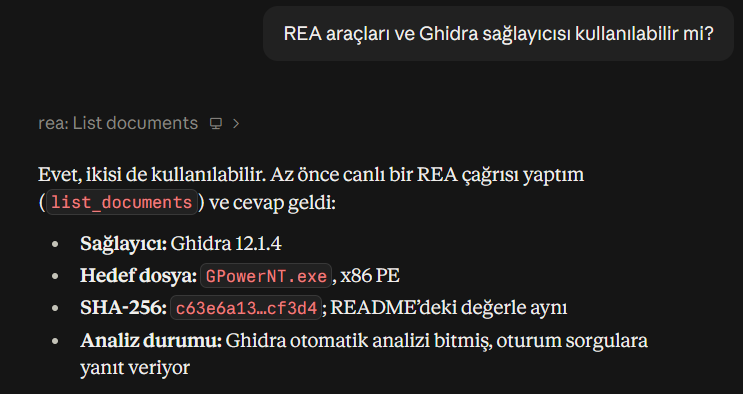

# powerlab — eşleştirilmiş t testi (t-paired) güç analizi: CLI + MCP + ajan

**Yapılan katmanlar:** ✅ Temel katman (CLI) · ✅ +15 MCP sunucusu · ✅ +10 AI ajanı (kural tabanlı çıkarıcı ölçüldü; LLM çıkarıcı kodda var ama bu teslimde API anahtarı olmadığı için **ölçülmedi**).

YZM301 Teardown Sprint · Grup 15 · Konu K2: t testi, eşleştirilmiş ortalama · Modlar: a priori (N hesapla), post hoc (güç hesapla).
Bu yazılım, güç analizi aracının (Faul, Erdfelder, Lang ve Buchner, 2007, 2009) davranışını **gözlem ve statik inceleme** ile yeniden uygulayan bağımsız bir çalışmadır; o yazılım değildir ve onun gibi sunulmaz.

## Atıf
Faul, F., Erdfelder, E., Lang, A.-G., & Buchner, A. (2007). G*Power 3: A flexible statistical power analysis program for the social, behavioral, and biomedical sciences. *Behavior Research Methods, 39*, 175–191.
Faul, F., Erdfelder, E., Buchner, A., & Lang, A.-G. (2009). Statistical power analyses using G*Power 3.1: Tests for correlation and regression analyses. *Behavior Research Methods, 41*, 1149–1160.

## İncelenen ikili dosya
Sürüm 3.1.9.7 (Windows), `GPowerNT.exe`, SHA-256: `c63e6a133eb6372932f810c08cc33dc35a06d1ddb658f897bd6c34a754efc812`. İkili dosya repoda **yoktur** (`.gitignore`), yalnızca resmi sayfadan alınır. Decompile çıktısı repoda yoktur.
Araçlar: REA 6.5.0 (npm `rea-agents`), Ghidra 12.1.4, JDK 21. REA'nın Ghidra sağlayıcısının kullanılabilir olduğu oturumda doğrulandı (`open_binary` + dize/xref/decompile çağrıları başarılı); ekran görüntüsü:



## Kurulum
```
pip install -e ".[test,mcp]"      # Python ≥ 3.9, scipy; MCP için mcp<2
```

## CLI
```
gpower-clone --test t-paired --mode a-priori --tails 2 --dz 0.5 --alpha 0.05 --power 0.80
{"n1":34,"n2":34,"n_total":34,"actual_power":0.8077775,"power":0.8077775,"critical":2.0345153,"df":33,"ncp":2.9154759}

gpower-clone --test t-paired --mode post-hoc --tails 2 --dz 0.5 --alpha 0.05 --n 34
gpower-clone --test t-paired --mode a-priori --tails 2 --dz 0 --alpha 0.05 --power 0.8
{"error": "In an a priori analysis, the absolute value of the effect size be greater than 0.00001."}   # çıkış kodu 2
```
`powerlab` ve `python -m powerlab` aynı programdır. `--d` = `--dz`; `--n`/`--n-total`/`--sample-size` post hoc örneklem. Tam davranış: **SPEC.md**.
Not: `CONTRACT.md` (t-paired parametre adları) bağlantısı ödev metninde yoktu; bu yüzden `--dz` ve `--n` varsayıldı ve takma adlar eklendi.

## MCP sunucusu (+15)
Çalıştırma: `powerlab-mcp` (stdio) ya da `python -m powerlab_mcp.server`. Hesap mantığı yoktur; `powerlab.cli.compute` çağrılır.

Araç: **`power_analysis_t_paired`**

| Girdi | Tür | Açıklama |
|---|---|---|
| mode | string | `a-priori` ya da `post-hoc` |
| tails | int | 1 ya da 2 |
| dz | number | etki büyüklüğü (−20…20) |
| alpha | number | (0,1) |
| power | number? | a-priori için hedef güç (alfa ≤ güç < 1) |
| n | int? | post-hoc için çift sayısı (3…2147483646) |

Çıktı (nesne): `n_total, n1, n2, actual_power, power, critical, df, ncp` ya da `{"error": "..."}`. CLI ↔ MCP eşliği: `tests/test_cli_mcp_parity.py` (40 vektör, gerçek stdio istemcisi).

## AI ajanı (+10)
`python agent/run_eval.py` → `agent/eval_report.md`, araç çağrı günlüğü `logs/tool_calls.jsonl`. Ajan test ailesi etiketini (t2-indep, t-paired, anova-oneway, chi2-contingency, multireg-r2, ambiguous, unsupported) ve güveni üretir; güven < 0,75 ya da etiket ambiguous/unsupported ise araştırmacıya sorar. **Sayıları yalnızca MCP aracı üretir.**
Sonuç (10 soru, kural tabanlı çıkarıcı): aile/yönlendirme 10/10, parametre 8/8, N/güç 8/8. **Dürüstlük notu:** kural tabanlı çıkarıcı bu 10 soruya bakılarak yazıldı; gerçek bir genelleme ölçümü değildir. Jev/LLM kalibrasyonu, İngilizce çeviri karşılaştırması ve GUI-ekran görüntüsü yoluyla *ölçülmüş* token/süre karşılaştırması **yapılmadı** (API anahtarı ve GUI ajanı yok). Yalnızca MCP yolunun boyutu ölçüldü (≈ 50 token/soru, karakter/4 tahmini); bir ekran görüntüsü yüzlerce–binlerce token olduğundan GUI yolu kabaca bir mertebe pahalıdır (varsayım, ölçüm değil).

## Testler
`python -m pytest -q tests` → 101 test. Uyum raporu: `tests/CONFORMANCE.md`. 40 G*Power arayüz vektörü (`oracle/`, ekran görüntüleri `oracle/screenshots/NN.png`) + 560 vektörlük ölçek testi.

## Belgeler
SPEC.md (Gherkin) · LEDGER.md · HALLUCINATIONS.md (5 kayıt) · AGENT_COST.md · prompts/ (iki oturumun ilk prompt'u). Temiz oda: oturum 2 yalnızca SPEC.md ile başladı (`prompts/session2_prompt.md`).

## Demo
`demo/demo.mp4` (≈ 49 sn): CLI a priori / post hoc / sınır / hata, Türkçe soruyla ajan→MCP ve test özeti. Bu bir ekran kaydı değil; `demo/make_video.py` gerçek komutları çalıştırıp yakaladığı çıktıları terminal görünümünde çizer (çıktılar uydurma değildir, betik yeniden üretir).

## Bilinen sınırlar
Alfa/güç için kesin geçerlilik aralıkları, |dz| ≤ 20 sınır mesajının ön eki ve çok küçük dz için üst sınır davranışı GUI'de doğrulanmadı ([AJAN], bkz. SPEC §8).
